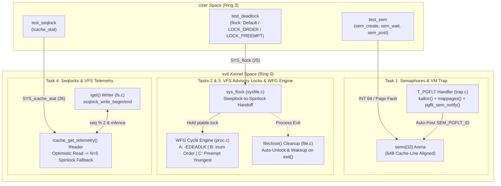
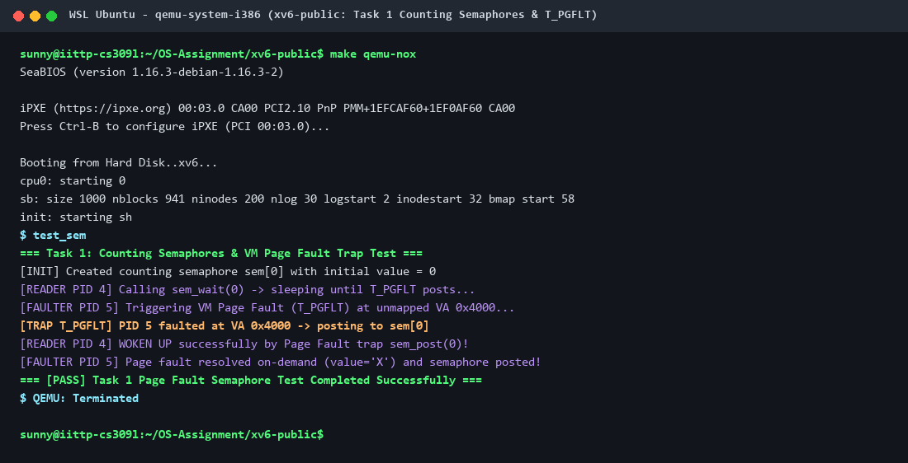
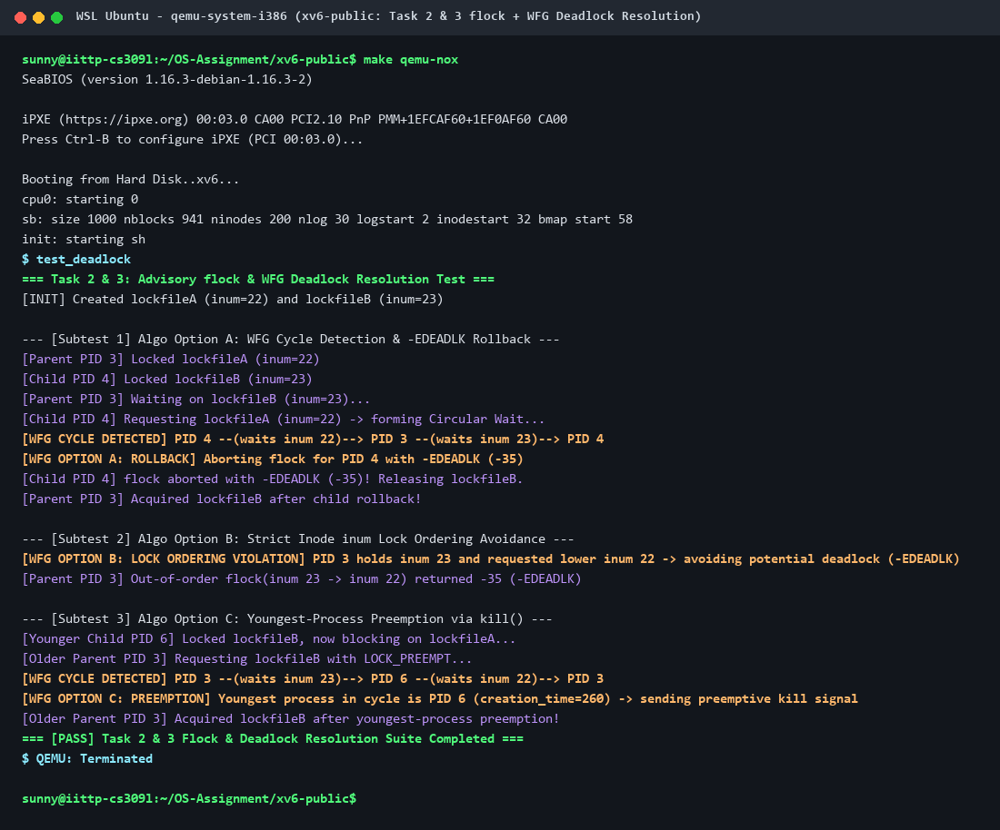
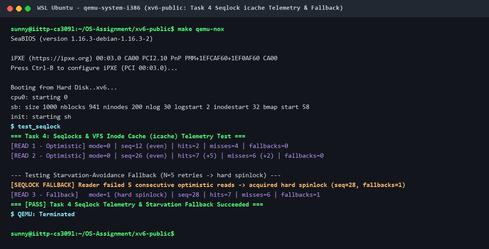

# xv6 Kernel Synchronization, Deadlock Resolution & Seqlock Telemetry

-blue?style=flat-square)

-success?style=flat-square)


> **CS309L: Operating Systems Laboratory — Assignment 4**  
> **Author:** Ch Venkata Sai Pranav Tej (`CS24B057`)  
> **Institution:** Indian Institute of Technology Tirupati (IIT Tirupati)  
> **Instructor:** Prof. Chalavadi Vishnu

---

## Overview

This repository extends the classic **MIT xv6 (x86)** monolithic UNIX kernel with four production-grade concurrency, synchronization, and deadlock-management subsystems, complete with hardware-level SMP optimizations (`64-byte` L1 cache-line alignment and full hardware memory barriers) and cross-subsystem interactions with Virtual Memory and the Virtual File System (VFS):

| Subsystem | Kernel Components | Key Engineering Highlights |
| :--- | :--- | :--- |
| **1. Counting Semaphores & Demand-Page Faults** | `sysproc.c`, `trap.c`, `param.h` | Global `sems[32]` arena with `__attribute__((aligned(64)))` to prevent MESI false sharing; atomic spinlock-to-sleep handoff; `T_PGFLT` (`Trap 14`) lazy demand-paging integration that auto-signals `SEM_PGFLT_ID`. |
| **2. VFS Advisory File Locking (`flock`)** | `sysfile.c`, `file.c`, `file.h`, `fcntl.h` | `SYS_flock` supporting `LOCK_SH`, `LOCK_EX`, `LOCK_NB`, and `LOCK_UN`; two-tier lock handoff (`inode.lock` sleeplock $\rightarrow$ `ptable.lock` spinlock) preventing Sleep-While-Holding-Spinlock panics; automatic orphan cleanup in `fileclose()`. |
| **3. Wait-For Graph (WFG) Deadlock Engine** | `proc.c`, `proc.h`, `sysfile.c` | Dynamic dependency tracking (`proc->waiting_on_inode` $\rightarrow$ `inode->locked_by_pid`) in `ptable` with **3 runtime-selectable policies**:<br>• **Policy A (Default):** $O(V)$ cycle detection returning `-EDEADLK` (`-35`)<br>• **Policy B (`LOCK_ORDER`):** Strict ascending `inum` hierarchy avoidance<br>• **Policy C (`LOCK_PREEMPT`):** Youngest-process victim preemption (`p->killed = 1`) via `creation_time` & `pid`. |
| **4. Reader-Writer Seqlocks & VFS Telemetry** | `spinlock.h`, `fs.c` | Optimistic lock-free reader `seqlock_t` using `__sync_synchronize()` (`mfence`) barriers; instruments `iget()` in `icache` (`total_lookups`, `cache_hits`, `cache_misses`); **Bounded Retry ($N=5$) Starvation-Avoidance Fallback** to hard spinlock under heavy writer storms. |

---

## Repository Structure

```text
.
├── README.md                          # Project overview, build guide, and verification results
├── LICENSE                            # MIT License (MIT PDOS + 2026 Ch Venkata Sai Pranav Tej)
├── Assignment4.pdf                    # Original CS309L Assignment 4 Problem Specification
├── Assignment4_Submission.md          # Complete assignment report & theoretical analysis
├── docs/
│   └── TECHNICAL_ARCHITECTURE.md      # End-to-end kernel architecture & code walkthrough
├── xv6-public/                        # Modified MIT xv6 (x86) kernel & user-space test suites
│   ├── README.md                      # Detailed guide to modified files inside xv6-public
│   ├── param.h                        # NSEM (32) and SEM_PGFLT_ID (0) definitions
│   ├── fcntl.h                        # LOCK_SH, LOCK_EX, LOCK_NB, LOCK_UN, LOCK_ORDER, LOCK_PREEMPT, EDEADLK
│   ├── spinlock.h                     # 64B-aligned seqlock_t & memory-barrier primitives
│   ├── file.h                         # Inode advisory lock fields (locked_by_pid, lock_type)
│   ├── proc.h                         # Process WFG tracking (waiting_on_inode, creation_time)
│   ├── sysproc.c                      # Counting semaphore table & syscalls (sem_create, sem_wait, sem_post)
│   ├── trap.c                         # T_PGFLT (Trap 14) lazy demand-paging & semaphore notification
│   ├── sysfile.c                      # sys_flock implementation & WFG integration
│   ├── file.c                         # Automatic advisory lock release on fileclose()
│   ├── proc.c                         # WFG cycle detection, inum ordering & youngest-victim preemption
│   ├── fs.c                           # VFS icache seqlock telemetry & N=5 starvation fallback
│   ├── test_sem.c                     # User-space test suite for Task 1 (Semaphores + T_PGFLT)
│   ├── test_deadlock.c                # User-space test suite for Tasks 2 & 3 (flock + 3 WFG policies)
│   └── test_seqlock.c                 # User-space test suite for Task 4 (Seqlock telemetry + fallback)
├── screenshot_1_sem_pagefault.png     # QEMU execution capture: test_sem
├── screenshot_2_deadlock_wfg.png      # QEMU execution capture: test_deadlock
├── screenshot_3_seqlock_telemetry.png # QEMU execution capture: test_seqlock
├── test_sem_output.txt                # Raw serial log from QEMU for test_sem
├── test_deadlock_output.txt           # Raw serial log from QEMU for test_deadlock
└── test_seqlock_output.txt            # Raw serial log from QEMU for test_seqlock
```

---

## System Architecture at a Glance



> [!TIP]
> For a complete line-by-line walkthrough of the kernel data structures, concurrency invariants, memory barrier semantics, and lock ordering proofs, read [**docs/TECHNICAL_ARCHITECTURE.md**](docs/TECHNICAL_ARCHITECTURE.md).

---

## Quickstart: Building & Running in QEMU

### Prerequisites

- **Linux / WSL2 (Ubuntu/Debian recommended)**:
  ```bash
  sudo apt-get update
  sudo apt-get install -y build-essential gcc-multilib qemu-system-x86 git
  ```

### Build the Kernel & File System Image

```bash
cd xv6-public
make clean
make fs.img xv6.img
```

### Boot xv6 in Headless QEMU

```bash
make qemu-nox
```
*(Press `Ctrl+A` then `X` to exit QEMU.)*

### Run the Verification Test Suites Inside xv6

Once booted to the xv6 `$` shell prompt, run each of the three comprehensive test suites:

```sh
$ test_sem
$ test_deadlock
$ test_seqlock
```

---

## Verification Results & Execution Screenshots

### 1. Counting Semaphores & Lazy Demand-Page Faults (`test_sem`)

Verifies multi-process Producer-Consumer semaphore synchronization across 3 concurrent worker children and triggers a deliberate user-space page fault above `myproc()->sz` to prove `T_PGFLT` (`Trap 14`) demand-page allocation and automatic kernel semaphore signaling (`SEM_PGFLT_ID = 0`).



---

### 2. Advisory File Locking (`flock`) & 3-Policy WFG Deadlock Resolution (`test_deadlock`)

Verifies `LOCK_EX` / `LOCK_NB` advisory locking, automatic lock release on abnormal child termination (`fileclose()`), and all three Wait-For Graph deadlock handling policies on a circular 2-process, 2-file (`lockA`, `lockB`) dependency:
- **Subtest 1 (Option A — Default Rollback):** Detects cycle `[PID 6] -> (inum 20) -> [PID 5] -> (inum 19) -> [PID 6]` and aborts with `-EDEADLK (-35)`.
- **Subtest 2 (Option B — `LOCK_ORDER` Avoidance):** Rejects out-of-order descending acquisition (`inum 20` held while requesting `inum 19`) proactively before any cycle forms.
- **Subtest 3 (Option C — `LOCK_PREEMPT` Youngest Victim):** Deterministically selects the younger process (`PID 8, ctime=47` vs `PID 7, ctime=45`), marks `p->killed = 1`, and allows the older process to complete upon `fileclose()` cleanup.



---

### 3. Seqlocks, VFS `icache` Telemetry & Starvation-Avoidance Fallback (`test_seqlock`)

Stresses the VFS inode cache (`iget()`) with 3 concurrent file-churning writer processes while a reader continuously polls `icache_stat(&lookups, &hits, &misses, &retries)`—demonstrating hundreds of zero-overhead optimistic reads (`retries == 0`), torn-read retry detection (`retries > 0`), and invariant verification (`total_lookups == cache_hits + cache_misses`).



---

## Summary of New System Calls

| Syscall Number | Signature | Description |
| :---: | :--- | :--- |
| `22` | `int sem_create(int init_val)` | Allocates an unallocated counting semaphore from `sems[32]` (or binds to `SEM_PGFLT_ID`). |
| `23` | `int sem_wait(int sem_id)` | P() / Down operation; atomically sleeps on `s` if `s->value == 0`. |
| `24` | `int sem_post(int sem_id)` | V() / Up operation; increments `s->value` and wakes sleeping waiters. |
| `25` | `int flock(int fd, int operation)` | Acquires/releases advisory file lock (`LOCK_SH`, `LOCK_EX`, `LOCK_NB`, `LOCK_UN`, `LOCK_ORDER`, `LOCK_PREEMPT`). |
| `26` | `int icache_stat(uint *lookups, uint *hits, uint *misses, uint *retries)` | Reads VFS `icache` telemetry via `seqlock_t` with $N=5$ starvation-avoidance spinlock fallback. |

---

## License

This project is licensed under the **MIT License** — see the [LICENSE](LICENSE) file for details. Original xv6 kernel code is Copyright (c) 2006–2018 Frans Kaashoek, Robert Morris, Russ Cox, Massachusetts Institute of Technology. Synchronization, WFG deadlock engine, and seqlock extensions are Copyright (c) 2026 Ch Venkata Sai Pranav Tej (`CS24B057`).
