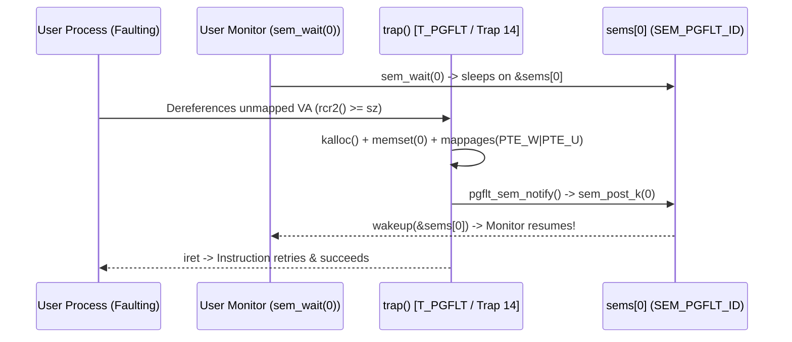
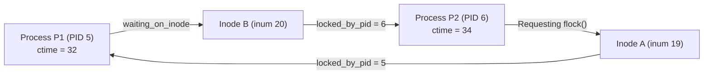

# End-to-End Technical Architecture & Kernel Internals

> **Project:** xv6 Synchronization Primitives, WFG Deadlock Engine & Seqlock VFS Telemetry  
> **Author:** Ch Venkata Sai Pranav Tej (`CS24B057`), IIT Tirupati  
> **Course:** CS309L Operating Systems Laboratory (Assignment 4)

---

## Table of Contents

1. [Architectural Overview](#1-architectural-overview)
2. [Task 1: Counting Semaphores & Demand-Paging Page Fault Trap (`T_PGFLT`)](#2-task-1-counting-semaphores--demand-paging-page-fault-trap-t_pgflt)
   - [2.1 Data Structure & 64-Byte Cache-Line Alignment](#21-data-structure--64-byte-cache-line-alignment)
   - [2.2 Lost-Wakeup Prevention via Atomic Spinlock-to-Sleep Handoff](#22-lost-wakeup-prevention-via-atomic-spinlock-to-sleep-handoff)
   - [2.3 Cross-Subsystem Integration: `T_PGFLT` (Trap 14) Demand Paging](#23-cross-subsystem-integration-t_pgflt-trap-14-demand-paging)
3. [Task 2: VFS Advisory File Locking (`flock`)](#3-task-2-vfs-advisory-file-locking-flock)
   - [3.1 Inode Metadata Extensions & Operation Flags](#31-inode-metadata-extensions--operation-flags)
   - [3.2 Two-Tier Lock Handoff (`inode.lock` Sleeplock $\rightarrow$ `ptable.lock` Spinlock)](#32-two-tier-lock-handoff-inodelock-sleeplock-rightarrow-ptablelock-spinlock)
   - [3.3 Automatic Orphan Lock Cleanup in `fileclose()`](#33-automatic-orphan-lock-cleanup-in-fileclose)
4. [Task 3: Wait-For Graph (WFG) Deadlock Detection, Avoidance & Preemption](#4-task-3-wait-for-graph-wfg-deadlock-detection-avoidance--preemption)
   - [4.1 Implicit Wait-For Graph Representation in `ptable`](#41-implicit-wait-for-graph-representation-in-ptable)
   - [4.2 Policy A: $O(V)$ Cycle Detection & Rollback (`-EDEADLK`)](#42-policy-a-ov-cycle-detection--rollback--edeadlk)
   - [4.3 Policy B: Strict `inum` Lock-Ordering Avoidance (`LOCK_ORDER`)](#43-policy-b-strict-inum-lock-ordering-avoidance-lock_order)
   - [4.4 Policy C: Youngest-Victim Preemption (`LOCK_PREEMPT`)](#44-policy-c-youngest-victim-preemption-lock_preempt)
5. [Task 4: Reader-Writer Seqlocks, VFS `icache` Telemetry & Starvation Avoidance](#5-task-4-reader-writer-seqlocks-vfs-icache-telemetry--starvation-avoidance)
   - [5.1 Seqlock Protocol & Hardware Memory Barriers (`mfence`)](#51-seqlock-protocol--hardware-memory-barriers-mfence)
   - [5.2 VFS `icache` Telemetry Instrumentation in `iget()`](#52-vfs-icache-telemetry-instrumentation-in-iget)
   - [5.3 Bounded Retry ($N=5$) Starvation-Avoidance Fallback](#53-bounded-retry-n5-starvation-avoidance-fallback)
6. [Complete Modified File Reference](#6-complete-modified-file-reference)

---

## 1. Architectural Overview

Modern multiprocessor kernels require synchronization mechanisms tailored to distinct contention regimes:
1. **Sleep-capable counting coordination** (`sem_wait` / `sem_post`) for producer-consumer pipelines and asynchronous trap notification (`T_PGFLT`).
2. **File-granularity advisory locking** (`flock`) integrated with the VFS object lifecycle (`fileclose`) and process termination (`exit`).
3. **Deadlock resilience** across multi-resource lock acquisitions via runtime cycle detection, lock-order enforcement, or deterministic victim preemption.
4. **Zero-overhead lockless read concurrency** (`seqlock_t`) for high-frequency kernel telemetry counters (`icache`) where reader spinlock acquisition would serialize all CPU cores.

---

## 2. Task 1: Counting Semaphores & Demand-Paging Page Fault Trap (`T_PGFLT`)

### 2.1 Data Structure & 64-Byte Cache-Line Alignment

In `xv6-public/sysproc.c`, the kernel maintains a global table of `NSEM = 32` counting semaphores:

```c
struct sem {
  struct spinlock lock; // Protects value and allocated state
  int value;            // Current semaphore count (>= 0)
  int allocated;        // 1 if active, 0 if free
} __attribute__((aligned(64)));

struct sem sems[NSEM];
```

**Why `__attribute__((aligned(64)))`?**  
On x86-64/i386 SMP processors using the **MESI cache-coherency protocol**, an L1 data cache line is `64 bytes`. Without alignment, adjacent `struct sem` entries (`sizeof(struct sem) < 64`) share a single cache line. If Core 0 performs atomic `xchg` operations on `sems[1].lock` while Core 1 spins on `sems[2].lock`, every write invalidates the shared cache line on the remote core (*cache-line ping-pong* / **false sharing**). Aligning each `struct sem` to a 64-byte boundary guarantees hardware isolation across cores.

### 2.2 Lost-Wakeup Prevention via Atomic Spinlock-to-Sleep Handoff

A classic concurrency bug occurs if a thread checks `s->value == 0`, releases the lock, and gets preempted before going to sleep—missing an intervening `sem_post()`. Our implementation in `sem_wait_k()` (`xv6-public/sysproc.c`) eliminates this race by passing `&s->lock` directly to `sleep(s, &s->lock)`:

```c
acquire(&s->lock);
while(s->value <= 0){
  if(myproc()->killed){
    release(&s->lock);
    return -1;
  }
  sleep(s, &s->lock); // Atomically acquires ptable.lock, sets SLEEPING, releases s->lock
}
s->value--;
release(&s->lock);
```

Inside `sleep()` (`proc.c`), `ptable.lock` is acquired *before* `s->lock` is released. Because `wakeup()` also acquires `ptable.lock`, no `sem_post_k()` call can observe the process in an intermediate state between checking `s->value` and setting `p->state = SLEEPING`.

### 2.3 Cross-Subsystem Integration: `T_PGFLT` (Trap 14) Demand Paging

In `xv6-public/trap.c`, we added a dedicated handler for `T_PGFLT` (`Trap 14`) that intercepts user-space memory faults within two pages above `myproc()->sz`, lazily allocates a zeroed physical frame via `kalloc()`, maps it with `PTE_W | PTE_U`, and calls `pgflt_sem_notify()` to automatically post to `SEM_PGFLT_ID (0)`:



---

## 3. Task 2: VFS Advisory File Locking (`flock`)

### 3.1 Inode Metadata Extensions & Operation Flags

We extended `struct inode` (`xv6-public/file.h`) with two fields tracking advisory lock ownership:
- `uint locked_by_pid`: PID of the owning process (`0` if unlocked, or first holder for shared locks).
- `int lock_type`: Active mode (`0` unlocked, `LOCK_SH = 1`, `LOCK_EX = 2`, and the internal bit `LOCK_SH_HELD = 0x100` where `lock_type >> 8` stores the reference count of concurrent shared readers).

### 3.2 Two-Tier Lock Handoff (`inode.lock` Sleeplock $\rightarrow$ `ptable.lock` Spinlock)

In xv6, `ip->lock` is a **sleeplock** (used during disk I/O), whereas `sleep()` requires a **spinlock** and internally acquires `ptable.lock`. Holding a spinlock while calling `ilock()` (which may sleep) causes an immediate kernel `panic("sched locks")`.

`sys_flock()` (`xv6-public/sysfile.c`) solves this via a strict lock-handoff protocol:
1. Acquire `ilock(ip)` briefly to ensure the in-memory inode is valid, then immediately call `iunlock(ip)`.
2. Acquire `ptable.lock` (`acquire(&ptable.lock)`) to synchronize `ip->lock_type`, `ip->locked_by_pid`, and the Wait-For Graph state (`curproc->waiting_on_inode`) in a single atomic domain.
3. Block via `sleep(ip, &ptable.lock)` when contended, which atomically releases `ptable.lock` while putting the caller to sleep on channel `ip`.

### 3.3 Automatic Orphan Lock Cleanup in `fileclose()`

If a process crashes or is terminated (`kill()` $\rightarrow$ `exit()`), `exit()` closes every open file descriptor via `fileclose()`. In `xv6-public/file.c`, we hooked `fileclose()` right before `iput(ff.ip)` to automatically release any advisory lock held by `myproc()->pid` and wake waiting processes:

```c
if(ff.type == FD_INODE && ff.ip != 0){
  acquire(&ptable.lock);
  if(ff.ip->locked_by_pid == myproc()->pid){
    ff.ip->locked_by_pid = 0;
    ff.ip->lock_type = 0;
    wakeup1_lock(ff.ip);
  }
  release(&ptable.lock);
}
```

---

## 4. Task 3: Wait-For Graph (WFG) Deadlock Detection, Avoidance & Preemption

### 4.1 Implicit Wait-For Graph Representation in `ptable`

Rather than dynamically allocating graph nodes inside the kernel (which risks out-of-memory failures during lock contention), our WFG is embedded directly inside `ptable` (`NPROC = 64` processes) and `icache`:
- **Wait Edge ($P_a \rightarrow R_x$):** Stored in `struct proc` as `struct inode *waiting_on_inode`.
- **Ownership Edge ($R_x \rightarrow P_b$):** Stored in `struct inode` as `uint locked_by_pid`.

Every directed hop $P_a \xrightarrow{\text{waits}} R_x \xrightarrow{\text{held by}} P_b$ is traversed while holding `ptable.lock`, guaranteeing a static snapshot of the graph.



### 4.2 Policy A: $O(V)$ Cycle Detection & Rollback (`-EDEADLK`)

When `requester` (`P2`) requests an exclusive lock on `target_ip` (`Inode A`), `wfg_check_and_resolve()` (`xv6-public/proc.c`) walks the chain starting at `holder_pid = target_ip->locked_by_pid`:

$$\text{curr\_pid} \longrightarrow p(\text{curr\_pid})\text{->waiting\_on\_inode->locked\_by\_pid}$$

If the traversal reaches `requester->pid` within `NPROC` hops, a cycle is confirmed. Under Policy A (default), the kernel clears `requester->waiting_on_inode = 0` and immediately returns `-EDEADLK (-35)` to user space.

### 4.3 Policy B: Strict `inum` Lock-Ordering Avoidance (`LOCK_ORDER`)

When `LOCK_ORDER` (`0x20`) is passed to `flock()`, `wfg_check_lock_order()` scans the caller's open file table (`requester->ofile[NOFILE]`). If the process already holds a lock on any inode `held_ip` with `held_ip->inum > target_ip->inum`, the request violates strict ascending `inum` order and is rejected immediately with `-EDEADLK (-35)`—making circular wait mathematically impossible.

### 4.4 Policy C: Youngest-Victim Preemption (`LOCK_PREEMPT`)

When `LOCK_PREEMPT` (`0x10`) is specified and a cycle is detected, the kernel inspects every process $P_i$ in the cycle and selects the **youngest process** as the preemption victim using `p->creation_time` (initialized from `ticks` in `allocproc()`, with highest `pid` as tie-breaker):
- **Case 1 (`victim == requester`):** Returns `-EDEADLK` immediately to the caller.
- **Case 2 (`victim != requester`):** Sets `victim->killed = 1` and wakes the victim if sleeping. The requester then sleeps on `target_ip`; as the victim unwinds through `trap()` $\rightarrow$ `exit()` $\rightarrow$ `fileclose()`, its locks are released automatically and the requester wakes up and acquires the lock!

---

## 5. Task 4: Reader-Writer Seqlocks, VFS `icache` Telemetry & Starvation Avoidance

### 5.1 Seqlock Protocol & Hardware Memory Barriers (`mfence`)

Defined in `xv6-public/spinlock.h`, `seqlock_t` pairs a standard writer spinlock with a monotonic sequence counter `seq`, aligned to 64 bytes:

```c
typedef struct seqlock {
  struct spinlock lock;
  volatile uint seq;
} __attribute__((aligned(64))) seqlock_t;
```

- **Writer Protocol (`seqlock_write_begin` / `seqlock_write_end`):**
  1. Acquires `sl->lock`.
  2. Increments `sl->seq++` to an **odd** number (signaling an active write-in-progress).
  3. Issues `__sync_synchronize()` (a full hardware `mfence` + compiler barrier) so no payload stores can be reordered before the odd sequence increment.
  4. Mutates protected telemetry fields.
  5. Issues `__sync_synchronize()`, increments `sl->seq++` to an **even** number, and releases `sl->lock`.

- **Reader Protocol (`seqlock_read_begin` / `seqlock_read_retry`):**
  1. Reads `s1 = sl->seq`. If `s1 & 1` (odd), a writer is mid-update.
  2. Issues `__sync_synchronize()`, copies the protected telemetry snapshot, and issues a second `__sync_synchronize()`.
  3. Checks `s1 != sl->seq`. If equal and even, the snapshot is guaranteed to be atomic and tear-free without having touched any lock or dirtied the cache line.

### 5.2 VFS `icache` Telemetry Instrumentation in `iget()`

In `xv6-public/fs.c`, `icache` tracks:
- `total_lookups`: Every call to `iget(dev, inum)`.
- `cache_hits`: Lookups satisfied by an already cached in-memory inode (`ip->ref > 0 && ip->dev == dev && ip->inum == inum`).
- `cache_misses`: Lookups that allocate an empty slot (`empty->ref == 0`) for a uncached disk inode.

Maintaining the strict invariant:

$$\text{total\_lookups} = \text{cache\_hits} + \text{cache\_misses}$$

### 5.3 Bounded Retry ($N=5$) Starvation-Avoidance Fallback

Pure optimistic seqlock readers suffer from **reader livelock/starvation** if writer frequency is so high that `seq` increments during every read attempt. In `icache_get_telemetry()` (`xv6-public/fs.c`), we bound the optimistic loop to `MAX_SEQLOCK_RETRIES = 5`:

```c
while(retries < 5){
  seq = seqlock_read_begin(&icache.tlock);
  if(seq & 1){
    retries++;
    continue;
  }
  l = icache.total_lookups;
  h = icache.cache_hits;
  m = icache.cache_misses;
  if(!seqlock_read_retry(&icache.tlock, seq)){
    // Fast path succeeded!
    return 0;
  }
  retries++;
}
// Starvation-Avoidance Fallback: Acquire writer spinlock after 5 failed attempts
acquire(&icache.tlock.lock);
l = icache.total_lookups;
h = icache.cache_hits;
m = icache.cache_misses;
release(&icache.tlock.lock);
```

This guarantees **bounded $O(1)$ worst-case latency** for readers even under adversarial writer storms.

---

## 6. Complete Modified File Reference

| File | Subsystem | Summary of Changes |
| :--- | :--- | :--- |
| [param.h](../xv6-public/param.h) | Task 1 | Added `NSEM (32)` and `SEM_PGFLT_ID (0)` |
| [syscall.h](../xv6-public/syscall.h) | All | Added syscall numbers `22`–`26` (`sem_create`, `sem_wait`, `sem_post`, `flock`, `icache_stat`) |
| [syscall.c](../xv6-public/syscall.c) | All | Registered `sys_sem_create`, `sys_sem_wait`, `sys_sem_post`, `sys_flock`, `sys_icache_stat` |
| [usys.S](../xv6-public/usys.S) | All | Added user-space syscall trap stubs (`SYSCALL(...)`) |
| [user.h](../xv6-public/user.h) | All | Declared user-space prototypes for new syscalls |
| [defs.h](../xv6-public/defs.h) | All | Declared kernel internal functions across subsystems |
| [main.c](../xv6-public/main.c) | Task 1 | Added `seminit()` during BSP kernel bootstrap |
| [sysproc.c](../xv6-public/sysproc.c) | Task 1 | Implemented 64B-aligned `sems[NSEM]`, `sem_create_k`, `sem_wait_k`, `sem_post_k`, `pgflt_sem_notify` |
| [trap.c](../xv6-public/trap.c) | Task 1 | Added `case T_PGFLT:` lazy demand page allocation + `pgflt_sem_notify()` |
| [fcntl.h](../xv6-public/fcntl.h) | Tasks 2 & 3 | Defined `LOCK_SH`, `LOCK_EX`, `LOCK_NB`, `LOCK_UN`, `LOCK_PREEMPT`, `LOCK_ORDER`, `EDEADLK` |
| [file.h](../xv6-public/file.h) | Task 2 | Extended `struct inode` with `locked_by_pid` and `lock_type` |
| [file.c](../xv6-public/file.c) | Task 2 | Added automatic lock release and `wakeup1_lock(ff.ip)` in `fileclose()` |
| [sysfile.c](../xv6-public/sysfile.c) | Tasks 2 & 3 | Implemented `sys_flock()` with WFG cycle checks and sleeplock-to-spinlock handoff |
| [proc.h](../xv6-public/proc.h) | Task 3 | Extended `struct proc` with `waiting_on_inode` and `creation_time` |
| [proc.c](../xv6-public/proc.c) | Task 3 | Implemented `wfg_check_lock_order()`, `wfg_check_and_resolve()`, and `wakeup1_lock()` |
| [spinlock.h](../xv6-public/spinlock.h) | Task 4 | Defined `seqlock_t` (64B aligned) and inline read/write barrier primitives |
| [fs.c](../xv6-public/fs.c) | Task 4 | Instrumented `icache` & `iget()` with `seqlock_t` and implemented `icache_get_telemetry()` |
| [Makefile](../xv6-public/Makefile) | Build / Test | Added `-Wno-infinite-recursion -Wno-array-bounds` and `_test_sem`, `_test_deadlock`, `_test_seqlock` |
| [test_sem.c](../xv6-public/test_sem.c) | Verification | User-space test suite for Task 1 |
| [test_deadlock.c](../xv6-public/test_deadlock.c) | Verification | User-space test suite for Tasks 2 & 3 |
| [test_seqlock.c](../xv6-public/test_seqlock.c) | Verification | User-space test suite for Task 4 |
